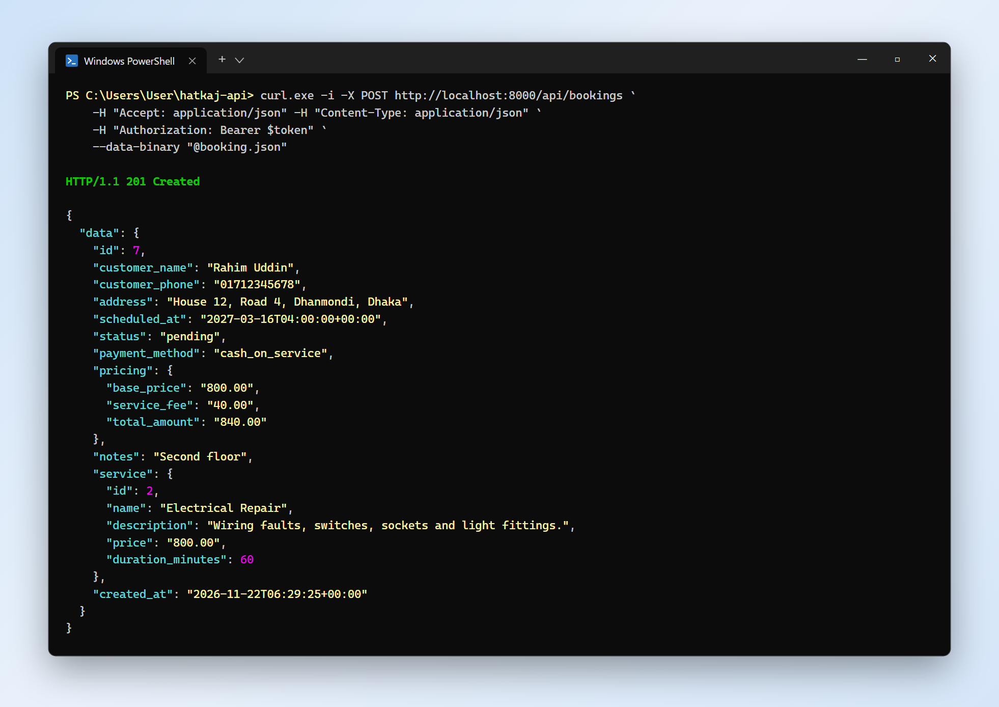
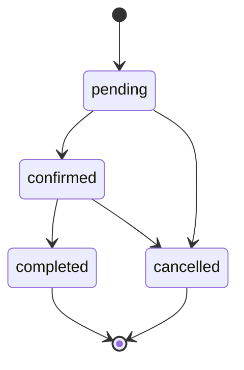
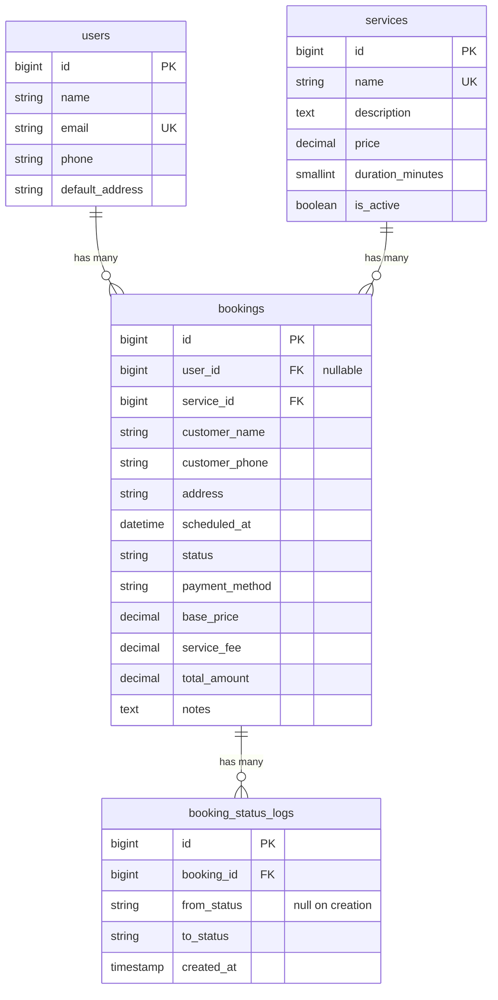

# HatKaj API

> **Mobile Client: [hatkaj-app](https://github.com/deXT-Sadman/hatkaj-app)**


REST API for **HatKaj**, a smart maintenance and service booking platform (AC servicing, plumbing, electrical, cleaning). It powers the [`hatkaj-app`](https://github.com/deXT-Sadman/hatkaj-app) Flutter client.

The interesting parts: **double-booking prevention**, a **status workflow with enforced transitions**, and an **audit log** of every status change. It runs fully local on SQLite with no paid services.

Real responses from the running API and test suite (captured in Windows Terminal, signed in as the seeded demo user):

| Create booking (201) | Slot conflict (409) |
|---|---|
|  |  |


## Contents
- [Features](#features)
- [Quick start](#quick-start)
- [API reference](#api-reference)
- [Booking status workflow](#booking-status-workflow)
- [Database design](#database-design)
- [Architecture](#architecture)
- [Testing](#testing)
- [Engineering trade-offs](#engineering-trade-offs)
- [Roadmap](#roadmap)

## Features
- Sanctum token auth (register, login, logout) and a profile with default contact details
- List active services, and your own bookings (paginated, filterable by `status`, `service_id`, `date`)
- Checkout preview with a server-side price breakdown (service fee, total) and a payment method choice; nothing is charged
- Create bookings with validation and slot-conflict detection; the price is snapshotted on the booking
- Ownership enforced: you can only see and change your own bookings
- Status workflow: `pending → confirmed → completed`, or `cancelled`, with invalid moves rejected
- Audit trail in `booking_status_logs` for every creation and status change
- Consistent JSON errors (`404`, `409`, `422`) and Eloquent API Resources
- 38 feature tests covering auth, checkout, ownership, the conflict rules and transitions

## Quick start

Requirements: PHP 8.3+, Composer.

```bash
composer install
cp .env.example .env
php artisan key:generate
touch database/database.sqlite        # PowerShell: ni database/database.sqlite
php artisan migrate --seed            # 5 services, a demo user and sample bookings
php artisan serve --host=0.0.0.0      # http://localhost:8000
```

`--host=0.0.0.0` lets the Android emulator (`10.0.2.2:8000`) and real devices on your LAN reach the API.

Seeded demo login: `demo@hatkaj.test` / `password`.

Try it:

```bash
curl -H "Accept: application/json" http://localhost:8000/api/services

# log in, then use the returned token on authenticated routes
curl -X POST http://localhost:8000/api/login -H "Accept: application/json" -H "Content-Type: application/json" \
  -d '{"email":"demo@hatkaj.test","password":"password"}'
```

## API reference

Base URL: `http://localhost:8000/api`. Send `Accept: application/json`. `/register` and `/login` are throttled to 5 requests per minute. Auth and profile routes use Laravel Sanctum bearer tokens (`Authorization: Bearer <token>`); all `/bookings` routes also require a token and only see the caller's own bookings.

| Method | Path | Description | Success |
|---|---|---|---|
| POST | `/register` | Create an account (`name`, `email`, `password` + `password_confirmation`, optional `phone`, `default_address`), returns `{ user, token }` | 201 |
| POST | `/login` | Log in, returns `{ user, token }` | 200 |
| POST | `/logout` | Revoke the current token (auth) | 200 |
| GET | `/profile` | Current user's profile (auth) | 200 |
| PUT | `/profile` | Update `name`, `phone`, `default_address` (auth) | 200 |
| GET | `/services` | Active services, sorted by name | 200 |
| GET | `/bookings` | Your paginated bookings, soonest first (auth) | 200 |
| POST | `/bookings/preview` | Checkout summary and price breakdown, nothing saved (auth) | 200 |
| POST | `/bookings` | Create a pending booking (auth) | 201 |
| PATCH | `/bookings/{id}/status` | Change your booking's status (auth) | 200 |

### Checkout

`POST /bookings/preview` and `POST /bookings` take the same body. `customer_name`, `customer_phone` and `address` default to the account profile when omitted. `payment_method` is `cash_on_service` (default) or `demo_wallet`; no payment is processed. Both responses carry `pricing: { base_price, service_fee, total_amount }`. The fee is `BOOKING_SERVICE_FEE_PERCENT` (default 5) of the service price, and `POST /bookings` stores it as a snapshot. Preview returns `409` if the slot is taken.

### GET /services

```json
{
  "data": [
    {
      "id": 1,
      "name": "AC Servicing",
      "description": "Cleaning and gas check for split or window AC units.",
      "price": "1200.00",
      "duration_minutes": 90
    }
  ]
}
```

`price` is a decimal string, which preserves precision. Parse it as a number on the client.

### GET /bookings

| Query | Type | Notes |
|---|---|---|
| `status` | enum | `pending`, `confirmed`, `completed`, `cancelled` |
| `service_id` | integer | Filter by service |
| `date` | `Y-m-d` | Bookings on that day |
| `per_page` | 1-50 | Default 15 |
| `page` | integer | Standard Laravel pagination |

Returns `data` (bookings with their `service`), plus `links` and `meta` (`current_page`, `last_page`, `total`, ...). The `meta.total` of a filtered query gives accurate counts for dashboards.

```bash
curl -H "Accept: application/json" -H "Authorization: Bearer $TOKEN" \
  "http://localhost:8000/api/bookings?status=pending&per_page=5"
```

### POST /bookings

```bash
curl -X POST http://localhost:8000/api/bookings \
  -H "Accept: application/json" -H "Content-Type: application/json" \
  -H "Authorization: Bearer $TOKEN" \
  -d '{
    "service_id": 1,
    "customer_name": "Rahim",
    "customer_phone": "01712345678",
    "address": "House 12, Road 4, Dhanmondi, Dhaka",
    "scheduled_at": "2026-12-30T10:00:00+06:00",
    "payment_method": "cash_on_service",
    "notes": "Second floor"
  }'
```

| Field | Rules |
|---|---|
| `service_id` | required, must be an **active** service |
| `customer_name` | required, max 100 (defaults to the profile name) |
| `customer_phone` | required, 7-20 digits, may start with `+` (defaults to the profile phone) |
| `address` | required, max 255 (defaults to the profile default address) |
| `payment_method` | optional, `cash_on_service` (default) or `demo_wallet` |
| `scheduled_at` | required, ISO 8601, must be in the future |
| `notes` | optional, max 500 |

**201 Created**

```json
{
  "data": {
    "id": 12,
    "customer_name": "Rahim",
    "customer_phone": "01712345678",
    "address": "House 12, Road 4, Dhanmondi, Dhaka",
    "scheduled_at": "2026-12-30T04:00:00+00:00",
    "status": "pending",
    "payment_method": "cash_on_service",
    "pricing": { "base_price": "1200.00", "service_fee": "60.00", "total_amount": "1260.00" },
    "notes": "Second floor",
    "service": { "id": 1, "name": "AC Servicing", "description": "Cleaning and gas check for split or window AC units.", "price": "1200.00", "duration_minutes": 90 },
    "created_at": "2026-11-21T12:00:00+00:00"
  }
}
```

**Errors**

| Code | Meaning | Body |
|---|---|---|
| 401 | Missing or invalid token | `{"message": "Unauthenticated."}` |
| 422 | Validation failed | `{"message": "...", "errors": {"field": ["..."]}}` |
| 409 | Slot already booked for that service | `{"message": "This time slot is already booked for the selected service."}` |

### PATCH /bookings/{id}/status

```bash
curl -X PATCH http://localhost:8000/api/bookings/12/status \
  -H "Accept: application/json" -H "Content-Type: application/json" \
  -H "Authorization: Bearer $TOKEN" \
  -d '{"status": "confirmed"}'
```

| Code | Meaning |
|---|---|
| 200 | Updated booking (same shape as above) |
| 403 | The booking belongs to another user |
| 404 | Unknown booking id (JSON) |
| 422 | Invalid status value, or a transition the workflow forbids, e.g. `{"message": "A completed booking cannot be changed to pending."}` |

## Booking status workflow



`completed` and `cancelled` are final. The rules live in one place, `BookingStatus::allowedTransitions()`.

## Database design



| Choice | Why |
|---|---|
| Index `bookings(service_id, scheduled_at)` | Serves the slot-conflict lookup |
| Index `bookings(user_id, scheduled_at)` | Serves the per-user booking list |
| Price snapshot on `bookings` | Later changes to `services.price` do not rewrite past orders |
| `user_id` is nullable, `nullOnDelete` | Bookings that predate accounts stay valid |
| Index `bookings(status)` | Serves the status filter and dashboard counts |
| `service_id` is `restrictOnDelete` | A service with bookings cannot be deleted by accident. Use `is_active` to retire it |
| `booking_status_logs` cascade on delete | The history is meaningless without its booking |
| `status` is a string cast to a PHP enum | Portable across databases and easy to extend |

## Architecture

```
HTTP request
   │
   ▼
Route ─► auth:sanctum ─► Controller (thin) ─► FormRequest (validation)
                                     └─► BookingPolicy (ownership → 403)
                 │
                 ▼
          BookingService  (business rules, DB transactions)
           │           │
           │           └─► SlotConflictException            → 409
           │           └─► InvalidStatusTransitionException → 422
           ▼
     Eloquent models ─► API Resources (JSON shape)
```

```
app/
├── Enums/                                  BookingStatus (+ transitions), PaymentMethod
├── Exceptions/                             render themselves as JSON responses
├── Http/
│   ├── Controllers/                        Auth, Profile, Service, Booking
│   ├── Requests/                           Register, Login, UpdateProfile, StoreBooking, UpdateBookingStatus
│   └── Resources/                          Booking, Service, User
├── Models/                                 User, Service, Booking, BookingStatusLog
├── Policies/BookingPolicy.php              only the owner may change a booking
└── Services/BookingService.php             preview, create, changeStatus, price quote
```

## Testing

```bash
php artisan test
```

Feature tests use in-memory SQLite with factories. They cover:
- registration, login, logout and profile updates
- booking creation, payload validation, price snapshot and the audit log
- checkout preview, payment method validation and profile defaults
- bookings scoped to the signed-in user, and 403 on someone else's booking
- same slot rejected, **overlapping** slots rejected, back-to-back slots allowed
- same time allowed for a *different* service
- a cancelled booking freeing its slot
- list filters, valid and invalid status transitions, JSON 404

## Engineering trade-offs

- **Slot-conflict rule.** Each service has a fixed duration, so two bookings of the same service overlap exactly when their start times are less than one duration apart. This needs no end-time column and one indexed query. It would need revisiting for variable-length jobs.
- **Concurrency.** The check and the insert run in one transaction with `lockForUpdate()`, which closes the race on MySQL/PostgreSQL. SQLite serialises writes, so it is safe locally. A PostgreSQL exclusion constraint would be the strongest guarantee.
- **Cancelled bookings free the slot.** Only `pending` and `confirmed` bookings block a time.
- **Service layer only where it earns its keep.** `BookingService` holds real business rules. Listing services is a plain read, so its controller queries the model directly.
- **Exceptions render themselves.** `SlotConflictException` and `InvalidStatusTransitionException` return their own JSON responses, keeping controllers free of try/catch.
- **Server-side totals.** `meta.total` on filtered queries lets clients show counts without downloading every booking.
- **Token auth for a mobile client.** Sanctum personal access tokens fit a Flutter app better than cookie sessions. Login and register are throttled.
- **Prices are snapshotted.** The fee is computed in integer cents and stored on the booking, so changing a service price or the fee percentage never alters existing orders.
- **No real payments.** `payment_method` is recorded for the client to display; nothing is charged.

## Roadmap
- Provider/admin roles, so someone other than the customer can confirm and complete bookings
- Real payment gateway integration
- Provider assignment and availability windows
- Rate limiting on booking creation
- OpenAPI/Swagger spec generated from the routes
- GitHub Actions workflow running tests and Pint
