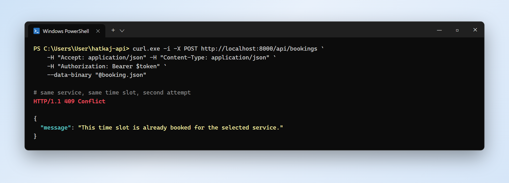
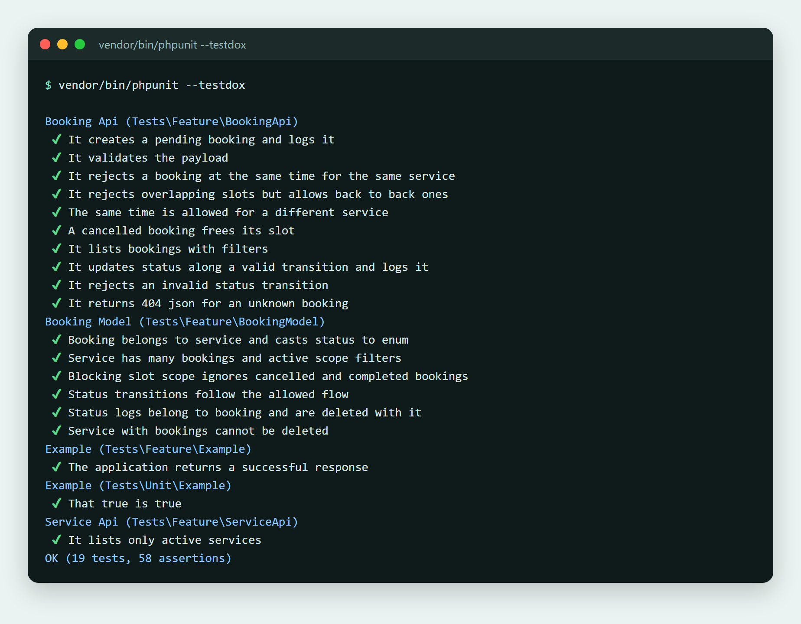

# HatKaj API

Backend for **HatKaj**, a smart maintenance and service booking platform (AC servicing, plumbing, electrical, cleaning). Built with Laravel; consumed by the [`hatkaj-app`](../hatkaj-app) Flutter client.

<!-- Screenshot placeholders: replace with real images in docs/screenshots/ -->
| Postman: create booking | 409 slot conflict | Test run |
|---|---|---|
|  |  |  |

## Features
- List active services and bookings (paginated, filterable by `status`, `service_id`, `date`)
- Create bookings with validation and **double-booking prevention**
- Booking status workflow with enforced transitions and an audit log
- Eloquent API Resources, FormRequests, feature tests (19 passing)
- Runs locally on SQLite, with no paid services

## Setup
```bash
composer install
cp .env.example .env
php artisan key:generate
touch database/database.sqlite      # PowerShell: ni database/database.sqlite
php artisan migrate --seed
php artisan serve --host=0.0.0.0    # http://localhost:8000
php artisan test
```

## Architecture
```
Controller (thin) -> FormRequest (validation) -> BookingService (business rules) -> Models
                                                     |-> SlotConflictException (409)
                                                     |-> InvalidStatusTransitionException (422)
```
- `app/Enums/BookingStatus.php`: statuses plus the allowed-transition map (single source of truth).
- `app/Services/BookingService.php`: slot-conflict check and status changes, each in a DB transaction.
- `booking_status_logs`: one row per status change (from/to), so history is never lost.

## API
Base URL: `/api`. Errors are JSON: `{"message": "..."}` (plus `errors` on 422).

| Method | Path | Description |
|---|---|---|
| GET | `/services` | Active services |
| GET | `/bookings` | Paginated. Query: `status`, `service_id`, `date` (Y-m-d), `per_page` (1-50), `page` |
| POST | `/bookings` | Create a pending booking |
| PATCH | `/bookings/{id}/status` | Change status |

**POST /api/bookings**
```json
{
  "service_id": 1,
  "customer_name": "Rahim",
  "customer_phone": "01712345678",
  "address": "Dhaka",
  "scheduled_at": "2026-12-30T10:00:00+06:00",
  "notes": "optional"
}
```
- `201` created, `422` validation error, `409` slot already booked.

**PATCH /api/bookings/{id}/status** with `{"status": "confirmed"}`

| From | Allowed next |
|---|---|
| pending | confirmed, cancelled |
| confirmed | completed, cancelled |
| completed / cancelled | none (`422`) |

## Key engineering trade-offs
- **Conflict rule**: each service has a fixed duration, so two bookings overlap exactly when their start times are less than one duration apart. This needs no end-time column. It would need revisiting for variable-length jobs.
- **Concurrency**: the check runs inside a transaction with `lockForUpdate()`. This is effective on MySQL/PostgreSQL. SQLite serialises writes anyway, so it is safe locally. A DB-level exclusion constraint would be stronger on Postgres.
- **Cancelled bookings free the slot**: only pending and confirmed bookings block it.
- **Status as string + PHP enum**: portable across databases and easy to extend, with transitions validated in code rather than DB enums.
- **No authentication**: a deliberate scope limit for the portfolio. Next step would be Sanctum with per-customer bookings.
- **Service layer**: used only where there is real business logic (bookings). Services are a plain read, so the controller queries directly.
