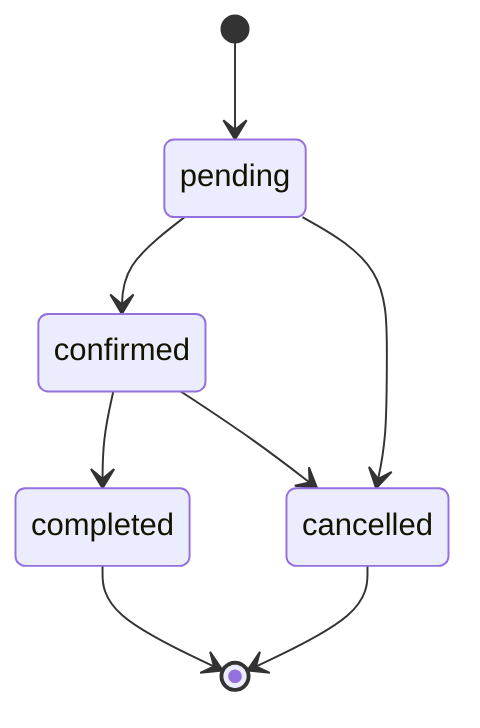
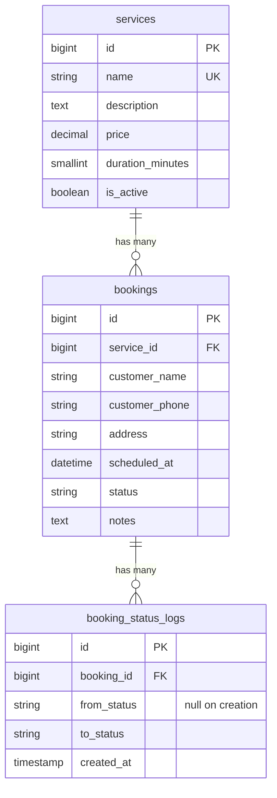

# HatKaj API


REST API for **HatKaj**, a smart maintenance and service booking platform (AC servicing, plumbing, electrical, cleaning). It powers the [`hatkaj-app`](https://github.com/deXT-Sadman/hatkaj-app) Flutter client.

The interesting parts: **double-booking prevention**, a **status workflow with enforced transitions**, and an **audit log** of every status change. It runs fully local on SQLite with no paid services.

Real responses from the running API and test suite:

| Create booking (201) | Slot conflict (409) |
|---|---|
|  |  |


## Contents
- [Features](#features)
- [Quick start](#quick-start)
- [API reference](#api-reference)
- [Booking status workflow](#booking-status-workflow)
- [Database design](#database-design)
- [Architecture](#architecture)
- [Testing](#testing)
- [Engineering trade-offs](#engineering-trade-offs)
- [Roadmap](#roadmap)

## Features
- List active services and bookings (paginated, filterable by `status`, `service_id`, `date`)
- Create bookings with validation and slot-conflict detection
- Status workflow: `pending → confirmed → completed`, or `cancelled`, with invalid moves rejected
- Audit trail in `booking_status_logs` for every creation and status change
- Consistent JSON errors (`404`, `409`, `422`) and Eloquent API Resources
- 19 feature tests covering the conflict rules and transitions

## Quick start

Requirements: PHP 8.3+, Composer.

```bash
composer install
cp .env.example .env
php artisan key:generate
touch database/database.sqlite        # PowerShell: ni database/database.sqlite
php artisan migrate --seed            # 5 sample services + sample bookings
php artisan serve --host=0.0.0.0      # http://localhost:8000
```

`--host=0.0.0.0` lets the Android emulator (`10.0.2.2:8000`) and real devices on your LAN reach the API.

Try it:

```bash
curl -H "Accept: application/json" http://localhost:8000/api/services
```

## API reference

Base URL: `http://localhost:8000/api`. Send `Accept: application/json`. No authentication (see [Roadmap](#roadmap)).

| Method | Path | Description | Success |
|---|---|---|---|
| GET | `/services` | Active services, sorted by name | 200 |
| GET | `/bookings` | Paginated bookings, soonest first | 200 |
| POST | `/bookings` | Create a pending booking | 201 |
| PATCH | `/bookings/{id}/status` | Change a booking's status | 200 |

### GET /services

```json
{
  "data": [
    {
      "id": 1,
      "name": "AC Servicing",
      "description": "Cleaning and gas check for split or window AC units.",
      "price": "1200.00",
      "duration_minutes": 90
    }
  ]
}
```

`price` is a decimal string, which preserves precision. Parse it as a number on the client.

### GET /bookings

| Query | Type | Notes |
|---|---|---|
| `status` | enum | `pending`, `confirmed`, `completed`, `cancelled` |
| `service_id` | integer | Filter by service |
| `date` | `Y-m-d` | Bookings on that day |
| `per_page` | 1-50 | Default 15 |
| `page` | integer | Standard Laravel pagination |

Returns `data` (bookings with their `service`), plus `links` and `meta` (`current_page`, `last_page`, `total`, ...). The `meta.total` of a filtered query gives accurate counts for dashboards.

```bash
curl -H "Accept: application/json" "http://localhost:8000/api/bookings?status=pending&per_page=5"
```

### POST /bookings

```bash
curl -X POST http://localhost:8000/api/bookings \
  -H "Accept: application/json" -H "Content-Type: application/json" \
  -d '{
    "service_id": 1,
    "customer_name": "Rahim",
    "customer_phone": "01712345678",
    "address": "House 12, Road 4, Dhanmondi, Dhaka",
    "scheduled_at": "2026-12-30T10:00:00+06:00",
    "notes": "Second floor"
  }'
```

| Field | Rules |
|---|---|
| `service_id` | required, must be an **active** service |
| `customer_name` | required, max 100 |
| `customer_phone` | required, 7-20 digits, may start with `+` |
| `address` | required, max 255 |
| `scheduled_at` | required, ISO 8601, must be in the future |
| `notes` | optional, max 500 |

**201 Created**

```json
{
  "data": {
    "id": 12,
    "customer_name": "Rahim",
    "customer_phone": "01712345678",
    "address": "House 12, Road 4, Dhanmondi, Dhaka",
    "scheduled_at": "2026-12-30T04:00:00+00:00",
    "status": "pending",
    "notes": "Second floor",
    "service": { "id": 1, "name": "AC Servicing", "price": "1200.00", "duration_minutes": 90 },
    "created_at": "2026-11-21T12:00:00+00:00"
  }
}
```

**Errors**

| Code | Meaning | Body |
|---|---|---|
| 422 | Validation failed | `{"message": "...", "errors": {"field": ["..."]}}` |
| 409 | Slot already booked for that service | `{"message": "This time slot is already booked for the selected service."}` |

### PATCH /bookings/{id}/status

```bash
curl -X PATCH http://localhost:8000/api/bookings/12/status \
  -H "Accept: application/json" -H "Content-Type: application/json" \
  -d '{"status": "confirmed"}'
```

| Code | Meaning |
|---|---|
| 200 | Updated booking (same shape as above) |
| 404 | Unknown booking id (JSON) |
| 422 | Invalid status value, or a transition the workflow forbids, e.g. `{"message": "A completed booking cannot be changed to pending."}` |

## Booking status workflow



`completed` and `cancelled` are final. The rules live in one place, `BookingStatus::allowedTransitions()`.

## Database design



| Choice | Why |
|---|---|
| Index `bookings(service_id, scheduled_at)` | Serves the slot-conflict lookup |
| Index `bookings(status)` | Serves the status filter and dashboard counts |
| `service_id` is `restrictOnDelete` | A service with bookings cannot be deleted by accident. Use `is_active` to retire it |
| `booking_status_logs` cascade on delete | The history is meaningless without its booking |
| `status` is a string cast to a PHP enum | Portable across databases and easy to extend |

## Architecture

```
HTTP request
   │
   ▼
Route ─► Controller (thin) ─► FormRequest (validation)
                 │
                 ▼
          BookingService  (business rules, DB transactions)
           │           │
           │           └─► SlotConflictException            → 409
           │           └─► InvalidStatusTransitionException → 422
           ▼
     Eloquent models ─► API Resources (JSON shape)
```

```
app/
├── Enums/BookingStatus.php                 statuses + allowed transitions
├── Exceptions/                             render themselves as JSON responses
├── Http/
│   ├── Controllers/                        BookingController, ServiceController
│   ├── Requests/                           StoreBookingRequest, UpdateBookingStatusRequest
│   └── Resources/                          BookingResource, ServiceResource
├── Models/                                 Service, Booking, BookingStatusLog
└── Services/BookingService.php             create + changeStatus
```

## Testing

```bash
php artisan test
```

Feature tests use in-memory SQLite with factories. They cover:
- booking creation, payload validation and the audit log
- same slot rejected, **overlapping** slots rejected, back-to-back slots allowed
- same time allowed for a *different* service
- a cancelled booking freeing its slot
- list filters, valid and invalid status transitions, JSON 404

## Engineering trade-offs

- **Slot-conflict rule.** Each service has a fixed duration, so two bookings of the same service overlap exactly when their start times are less than one duration apart. This needs no end-time column and one indexed query. It would need revisiting for variable-length jobs.
- **Concurrency.** The check and the insert run in one transaction with `lockForUpdate()`, which closes the race on MySQL/PostgreSQL. SQLite serialises writes, so it is safe locally. A PostgreSQL exclusion constraint would be the strongest guarantee.
- **Cancelled bookings free the slot.** Only `pending` and `confirmed` bookings block a time.
- **Service layer only where it earns its keep.** `BookingService` holds real business rules. Listing services is a plain read, so its controller queries the model directly.
- **Exceptions render themselves.** `SlotConflictException` and `InvalidStatusTransitionException` return their own JSON responses, keeping controllers free of try/catch.
- **Server-side totals.** `meta.total` on filtered queries lets clients show counts without downloading every booking.
- **No authentication yet.** A deliberate scope limit for a portfolio project.

## Roadmap
- Sanctum authentication with per-customer bookings
- Provider assignment and availability windows
- Rate limiting on booking creation
- OpenAPI/Swagger spec generated from the routes
- GitHub Actions workflow running tests and Pint
